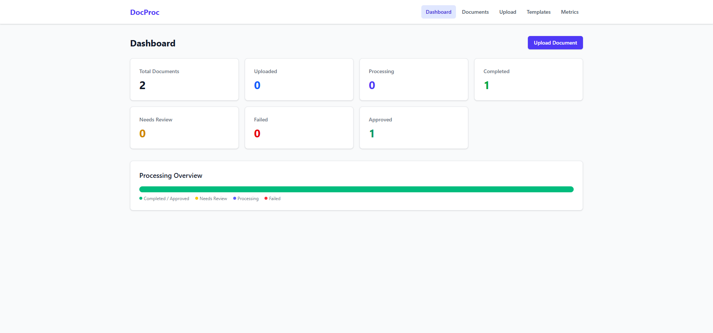
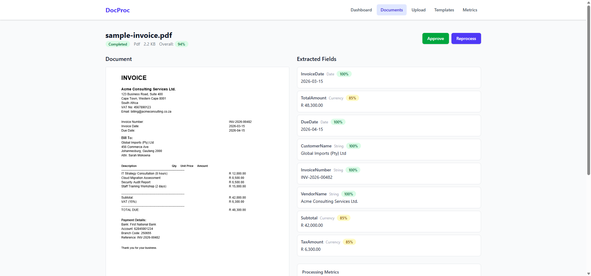
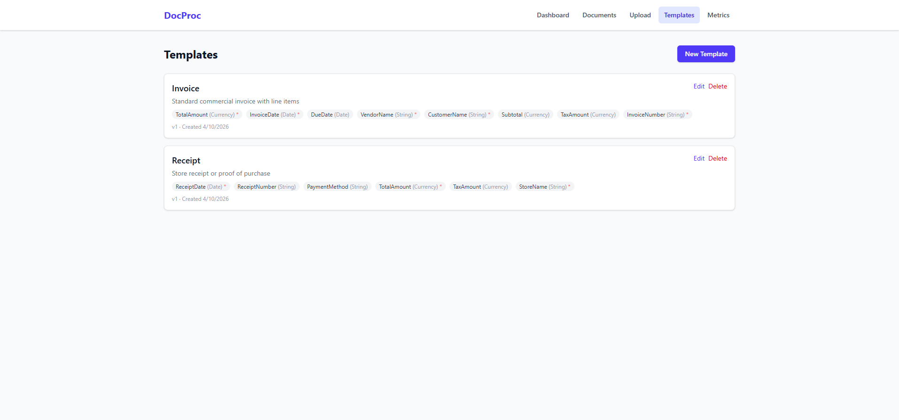
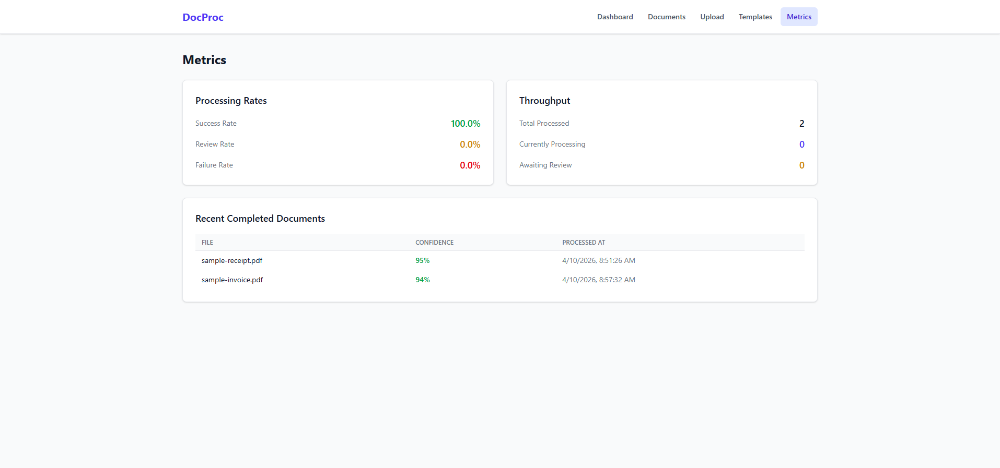
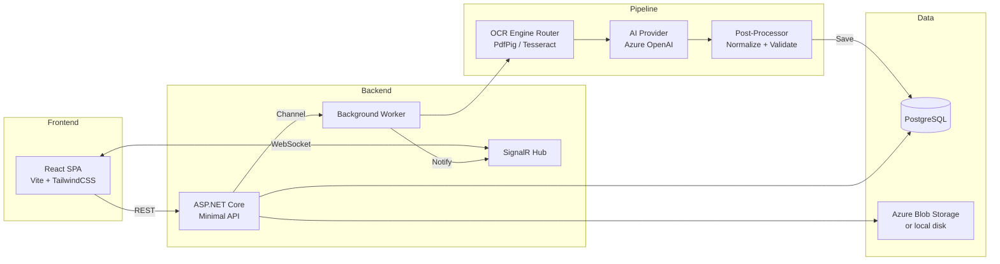

# DocProc — AI-Powered Document Processing Platform

[](https://github.com/c-dobkins/doc-proc/actions/workflows/ci.yml)
[](https://dotnet.microsoft.com/)
[](https://react.dev/)
[](https://www.typescriptlang.org/)
[](https://azure.microsoft.com/products/ai-services/openai-service)
[](https://learn.microsoft.com/dotnet/aspire/)
[](LICENSE)

> Upload any document. Get structured data back — powered by OCR and GPT-4.1.

DocProc is a full-stack document processing platform that extracts structured fields from PDFs and images using a multi-stage pipeline: **OCR → AI extraction → human review**. Configure extraction templates, get per-field confidence scores, and approve results through a modern React UI with real-time updates.

🔗 **[System Design](docs/architecture/SYSTEM_DESIGN.md)** · **[ADRs](docs/architecture/adr/)** · **[Deploy your own](#deploy-to-azure)**

## Engineering highlights

- **End-to-end pipeline:** ingestion → image pre-processing → dual OCR (PdfPig + Tesseract, including mixed PDFs) → LLM extraction → rule-based post-processing → confidence routing → human review, all processed asynchronously with live SignalR updates.
- **Provider-agnostic AI:** one interface over Azure OpenAI, OpenAI, Gemini and Ollama, with configurable fallback; document text is never placed in the system prompt, which limits prompt injection.
- **Production-minded:**
  - EF Core migrations, with safe baselining of existing databases
  - keyless managed-identity access to Azure Blob Storage
  - a fail-closed access model and rate limiting
  - hardened file handling
  - graceful shutdown and crash recovery
- **Tested for real:** 240+ backend tests, including API integration tests, migrations against real PostgreSQL, and one storage contract suite run against both Azure (Azurite) and local disk. Frontend tests run under Vitest. CI on every push.
- **Documented decisions:** a [system design](docs/architecture/SYSTEM_DESIGN.md) that describes the code as built, and [eight ADRs](docs/architecture/adr/) covering trade-offs and alternatives.

---

## Screenshots

<table>
  <tr>
    <td><br/><em>Dashboard — status overview & progress bar</em></td>
    <td><br/><em>Document Review — PDF viewer with extracted fields</em></td>
  </tr>
  <tr>
    <td><br/><em>Templates — configure extraction schemas</em></td>
    <td><br/><em>Metrics — processing rates & throughput</em></td>
  </tr>
</table>

---

## Features

- **Multi-format ingestion** — PDF, JPEG, PNG, TIFF, BMP up to 50 MB, with file-signature (magic byte) validation
- **Dual OCR strategy** — PdfPig for digital PDFs, Tesseract for scanned pages and images (including scanned pages inside mixed PDFs)
- **AI field extraction** — Azure OpenAI GPT-4.1 with configurable extraction templates
- **Per-field confidence scores** — automatic routing based on thresholds (auto-approve ≥ 90%, human review < 90%)
- **Human-in-the-loop review** — side-by-side PDF viewer with inline field editing, correction logging
- **Real-time updates** — SignalR pushes status changes to the browser as documents process
- **Extraction templates** — define field schemas (name, type, required) for invoices, receipts, or any document type
- **Processing metrics** — success rates, throughput, per-document OCR/AI timing breakdowns
- **Image preprocessing** — EXIF auto-orientation, contrast enhancement and grayscale conversion via Magick.NET
- **Demo-safe access model** — public read-only browsing; uploads and edits require an access key; rate limiting on OCR/AI endpoints

## Architecture



**Pipeline flow:** Upload → Pre-process (orient, grayscale, contrast) → OCR (routes by document type) → AI extraction (structured JSON) → Post-process (normalize dates, currencies, validate) → Store → UI review

### Key Design Decisions

| ADR | Decision | Rationale |
|-----|----------|-----------|
| [ADR-0001](docs/architecture/adr/0001-modular-monolith.md) | Modular monolith | Right-sized for the domain; splits cleanly later |
| [ADR-0002](docs/architecture/adr/0002-postgresql-database.md) | PostgreSQL | Relational integrity plus JSON support; first-class on Azure |
| [ADR-0003](docs/architecture/adr/0003-multi-provider-ai.md) | Multi-provider AI abstraction | Swap between Azure OpenAI, OpenAI, Gemini, Ollama via configuration, with fallback order |
| [ADR-0004](docs/architecture/adr/0004-channel-based-async.md) | Channel-based async processing | `System.Threading.Channels` for backpressure without external queues |
| [ADR-0005](docs/architecture/adr/0005-dual-ocr-strategy.md) | Dual OCR strategy | PdfPig for digital (fast, accurate), Tesseract for scanned (broad format support) |
| [ADR-0006](docs/architecture/adr/0006-api-key-access-model.md) | Public reads, API key for writes | Demo stays explorable; uploads and AI spend limited to key holders; fails closed |
| [ADR-0007](docs/architecture/adr/0007-magick-net-image-processing.md) | Magick.NET for images | No license key, TIFF support, explicit decoders for safety |
| [ADR-0008](docs/architecture/adr/0008-blob-storage-backends.md) | Azure Blob Storage, auto-selected | Durable uploads with managed identity; Azurite locally |

## Tech Stack

| Layer | Technology |
|-------|-----------|
| **API** | .NET 10, ASP.NET Core Minimal APIs, SignalR, FluentValidation, Serilog |
| **Frontend** | React 19, TypeScript 6, Vite 8, Tailwind CSS 4, TanStack Query v5, React Router 8, pdf.js 6 |
| **OCR** | PdfPig 0.1.16, Tesseract 5.2, Magick.NET (image pre-processing) |
| **AI** | Azure OpenAI (GPT-4.1, via the OpenAI .NET SDK and Azure's v1 endpoint), with OpenAI / Gemini / Ollama adapters |
| **Database** | PostgreSQL (EF Core 10 migrations, Npgsql) |
| **Storage** | Azure Blob Storage (managed identity) in production, Azurite locally, or local disk |
| **Orchestration** | .NET Aspire (local dev), Azure Container Apps (production) |
| **Observability** | OpenTelemetry (traces, metrics, logs), Aspire Dashboard |
| **Testing** | xUnit v3 on Microsoft.Testing.Platform, NSubstitute, WebApplicationFactory, PostgreSQL + Azurite integration tests; Vitest + Testing Library (web) |
| **CI** | GitHub Actions (build, test, lint, vulnerability audit, Docker build), Dependabot |

## Getting Started

### Prerequisites

- [.NET 10 SDK](https://dotnet.microsoft.com/download/dotnet/10.0)
- [Node.js 24 LTS](https://nodejs.org/) (22.12+ also works)
- [Docker Desktop](https://www.docker.com/products/docker-desktop/) (for PostgreSQL via Aspire)
- [Aspire CLI](https://learn.microsoft.com/dotnet/aspire/fundamentals/cli-tooling) — `dotnet tool install -g aspire`
- Optional, for OCR of scanned documents and images when running locally: Tesseract language data (`eng.traineddata`, from [tessdata](https://github.com/tesseract-ocr/tessdata)) in `src/DocumentProcessing.Api/tessdata/`. On Linux and macOS you also need the Tesseract/Leptonica libraries installed. Digital PDFs don't need Tesseract, and the Docker image includes it.

### 1. Clone & install

```bash
git clone https://github.com/c-dobkins/doc-proc.git
cd doc-proc

# Frontend dependencies
cd src/DocumentProcessing.Web && npm install && cd ../..
```

### 2. Configure an AI provider

Without an AI provider, OCR still runs but extraction fails, so documents end up `Failed` (or `NeedsReview` when no template is assigned). Store credentials with .NET user secrets, never in `appsettings.json`:

```bash
cd src/DocumentProcessing.Api
dotnet user-secrets set "AiProviders:AzureOpenAi:Endpoint" "https://<your-resource>.openai.azure.com"
dotnet user-secrets set "AiProviders:AzureOpenAi:ApiKey" "<your-key>"
dotnet user-secrets set "AiProviders:AzureOpenAi:DeploymentName" "gpt-4.1"
```

To use OpenAI, Gemini or a local Ollama model instead, set `AiProviders:<Provider>:Enabled` to `true`, add its key or URL, and change `AiProviders:DefaultProvider` (see [Configuration](#configuration)).

### 3. Run with Aspire

```bash
# From the repo root
aspire run
```

This starts:
- **PostgreSQL** container (auto-provisioned, persisted in a Docker volume)
- **Azurite** (Azure Storage emulator) for uploaded files, so local runs use the same blob code as production
- **API** (`api` resource) with the SignalR hub and the background processing worker
- **React SPA** (`web` resource) served by Vite, proxying `/api` and `/hubs` to the API
- **Aspire Dashboard** (URL printed by `aspire run`) with OpenTelemetry traces, logs and metrics

Ports are assigned by Aspire; open each resource from the dashboard.

On first start the database schema is created through migrations and seeded with a sample invoice and receipt, plus matching extraction templates. Locally the app runs in Development, where the access key isn't required.

### 4. Try it out

1. Open the `web` endpoint from the Aspire dashboard
2. Go to **Documents** — you'll see two seed documents
3. Click a document → **Reprocess** to run the full pipeline
4. Watch status update in real-time via SignalR
5. Review extracted fields, edit if needed, then **Approve**

## Deploy to Azure

Deploy to Azure Container Apps + Azure Database for PostgreSQL using the Azure Developer CLI:

### Prerequisites

- [Azure Developer CLI (`azd`)](https://learn.microsoft.com/azure/developer/azure-developer-cli/install-azd)
- [Docker Desktop](https://www.docker.com/products/docker-desktop/) (for building the container image)
- An Azure subscription with credits

### Deploy

```bash
# Login to Azure
azd auth login

# Provision infrastructure + deploy (first time)
azd up
```

You'll be prompted to select a subscription and region. `azd` will:
1. Create a resource group
2. Provision Azure Container Apps Environment
3. Provision Azure Database for PostgreSQL Flexible Server
4. Provision an Azure Storage account (container `documents`) for uploaded files, accessed keylessly via the app's managed identity
5. Build the Docker image (API + React SPA)
6. Deploy to Azure Container Apps

### Configure AI provider in Azure

After deployment, store the Azure OpenAI key as a secret and point the app at your resource and deployment:

```bash
az containerapp secret set \
  --name <your-container-app-name> \
  --resource-group <your-resource-group> \
  --secrets "ai-api-key=<your-azure-openai-key>"

az containerapp update \
  --name <your-container-app-name> \
  --resource-group <your-resource-group> \
  --set-env-vars \
    "AiProviders__AzureOpenAi__Endpoint=https://<your-resource>.openai.azure.com" \
    "AiProviders__AzureOpenAi__DeploymentName=<your-deployment>" \
    "AiProviders__AzureOpenAi__ApiKey=secretref:ai-api-key"
```

### Enable uploads (access key)

Deployments are read-only until an access key is configured. Generate one (at least 24 characters) and store it as a secret:

```bash
KEY=$(openssl rand -base64 32)
az containerapp secret set \
  --name <your-container-app-name> \
  --resource-group <your-resource-group> \
  --secrets "docproc-access-key=$KEY"

az containerapp update \
  --name <your-container-app-name> \
  --resource-group <your-resource-group> \
  --set-env-vars "Auth__ApiKeys__0=secretref:docproc-access-key"
```

Then click **Enter access key** in the app header. Share the key only with people who should be able to upload.

### File storage

On Azure, uploaded files go to the provisioned Storage account: azd sets `AZURE_STORAGE_BLOB_ENDPOINT` and grants the app's managed identity *Storage Blob Data Contributor*, and the API picks Azure Blob Storage automatically (no keys). Without any storage settings the API falls back to local disk and logs a warning, because container disks are wiped on restart. To use a specific account, set `BlobStorage__Azure__ServiceUri` (managed identity) or `BlobStorage__Azure__ConnectionString`.

### Database schema

The schema is managed by EF Core migrations and applied automatically on startup. Databases created by earlier versions (which used `EnsureCreated`) are detected and baselined automatically, provided their schema matches; otherwise startup stops with an explanation.

### Tear down

```bash
azd down  # Removes all Azure resources
```

## Configuration

Settings live in `src/DocumentProcessing.Api/appsettings*.json` and can be overridden with environment variables (`Section__Key`, e.g. `Auth__ApiKeys__0`). Put secrets in user secrets (local) or Container App secrets (Azure).

| Setting | Default | Purpose |
|---------|---------|---------|
| `ConnectionStrings:documentprocessing` | set by Aspire / azd | PostgreSQL connection |
| `AiProviders:DefaultProvider`, `AiProviders:FallbackOrder` | `AzureOpenAI`; `OpenAI, Gemini, Ollama` | Which provider to use, and which to try if it's unavailable |
| `AiProviders:<Provider>:Enabled` / `ApiKey` / `Endpoint` / `Model` / `DeploymentName` | Azure OpenAI enabled | Per-provider settings (`AzureOpenAi`, `OpenAi`, `Gemini`, `Ollama`) |
| `Auth:RequireApiKeyForWrites` | `true` (`false` in Development) | Require `X-Api-Key` for writes |
| `Auth:ApiKeys` | empty: read-only | Accepted access keys (24+ characters) |
| `BlobStorage:Provider` | `Auto` | `Auto`, `Azure` or `Local` |
| `BlobStorage:Azure:ServiceUri` / `ConnectionString` / `ContainerName` | from azd / Aspire; `documents` | Azure Blob Storage ([ADR-0008](docs/architecture/adr/0008-blob-storage-backends.md)) |
| `BlobStorage:BasePath` | `uploads` | Local-disk storage folder |
| `Processing:AutoApproveThreshold` | `90` | Confidence (%) at or above which documents are auto-approved |
| `Processing:MaxConcurrency` | `5` | Documents processed in parallel |
| `RateLimiting:ProcessingPermitsPerMinute` | `30` | Upload/reprocess calls allowed per minute (shared) |
| `Tesseract:TessDataPath`, `Tesseract:Language` | `./tessdata`, `eng` | OCR language data |

## Project Structure

```
DocumentProcessing/
├── DocumentProcessing.AppHost/          # .NET Aspire orchestrator
├── DocumentProcessing.ServiceDefaults/  # Shared OpenTelemetry, health checks, resilience
├── src/
│   ├── DocumentProcessing.Api/          # ASP.NET Core API + SignalR hub
│   │   ├── Auth/                        # API-key authentication
│   │   ├── Endpoints/                   # Minimal API endpoint groups
│   │   ├── Hubs/                        # SignalR processing hub
│   │   ├── Validators/                  # FluentValidation rules
│   │   └── Middleware/                  # Global exception handling
│   ├── DocumentProcessing.Core/         # Domain models, interfaces, enums
│   │   ├── Models/                      # Document, ProcessingResult, ExtractionTemplate
│   │   └── Interfaces/                  # Repository & service contracts
│   ├── DocumentProcessing.Infrastructure/
│   │   ├── Ai/                          # AI providers, prompt builder, response parser
│   │   ├── Ocr/                         # PdfPig + Tesseract engines, router
│   │   ├── Pipeline/                    # Ingestion handler + processing pipeline
│   │   ├── Data/                        # EF Core context, migrations, repositories, seed data
│   │   └── Storage/                     # Azure Blob + local disk storage
│   ├── DocumentProcessing.Web/          # React SPA
│   │   └── src/
│   │       ├── api/                     # API client, hooks, types
│   │       ├── components/              # FieldEditor, ConfidenceBadge, PDFViewer
│   │       └── pages/                   # Dashboard, DocumentList, DocumentReview, etc.
│   └── DocumentProcessing.Worker/       # Background processing worker (library, hosted by the API)
├── tests/
│   └── DocumentProcessing.Tests/        # Unit, API, PostgreSQL and storage tests (xUnit v3)
└── docs/
    ├── architecture/                    # System design + ADRs
    └── screenshots/
```

## Testing

```bash
dotnet test                                   # backend: no Docker, PostgreSQL or Tesseract needed
cd src/DocumentProcessing.Web && npm test     # frontend
```

Backend tests cover:
- the OCR router, AI providers and response parsing, prompt building
- pre- and post-processing, validation, the worker
- both storage backends
- the HTTP API end to end (`WebApplicationFactory`)

PostgreSQL and Azure Storage (Azurite) integration tests run when their connection strings are set; CI always runs them, plus a Docker build. See [CONTRIBUTING.md](CONTRIBUTING.md) for the full checklist.

## Security

Reads are public; anything that changes data or triggers OCR/AI needs an access key (`X-Api-Key`), which the UI asks for via **Enter access key**. Without a configured key, non-Development deployments run read-only. Processing endpoints are also rate-limited, uploads are size- and signature-checked, images are decoded only by the coder matching their type, and blob paths are guarded against traversal. There are no user accounts, so don't use a public deployment for sensitive documents. See [SECURITY.md](SECURITY.md).

## Documentation

| Document | Contents |
|----------|----------|
| [System design](docs/architecture/SYSTEM_DESIGN.md) | Architecture, components, data flow, security, failure modes, known limitations |
| [ADRs](docs/architecture/adr/) | Architecture decisions and their trade-offs |
| [CONTRIBUTING.md](CONTRIBUTING.md) | Setup, workflow, and checks to run before a pull request |
| [CLAUDE.md](CLAUDE.md) | Conventions and repo-specific gotchas (for humans and AI assistants) |
| [CHANGELOG.md](CHANGELOG.md) | Notable changes |
| [SECURITY.md](SECURITY.md) | Access model and how to report vulnerabilities |
| [API requests](src/DocumentProcessing.Api/DocumentProcessing.Api.http) | Ready-to-run HTTP requests for every endpoint |

## License

[MIT](LICENSE)

---

Built with .NET 10, React 19, Azure OpenAI, and .NET Aspire.
