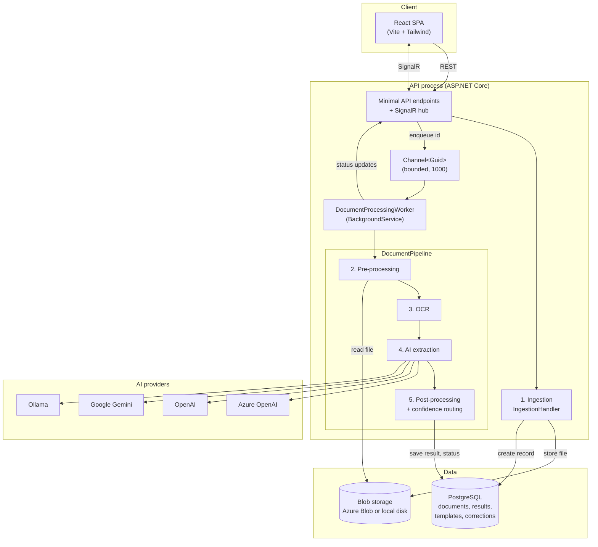
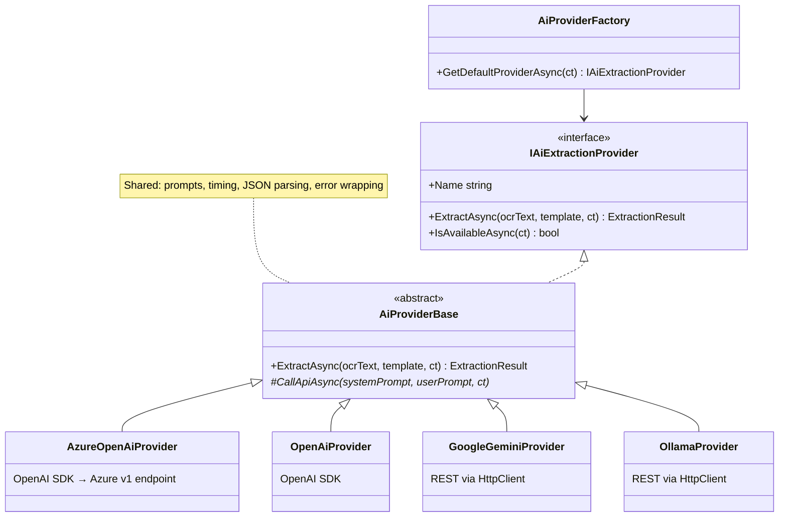
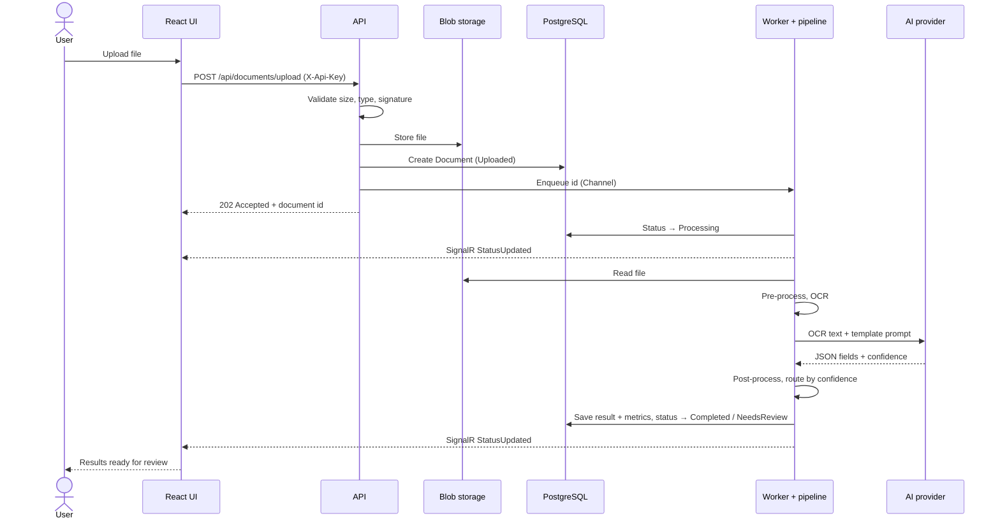
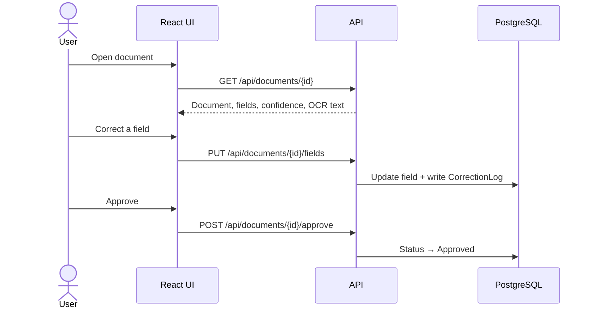

# System Design: DocProc

DocProc extracts structured data from documents. A user uploads a PDF or image; the system reads
the text (PdfPig for digital PDFs, Tesseract for scans), asks an LLM to fill in the fields defined
by an extraction template, validates and normalizes the result, and either auto-approves it or
queues it for human review.

This document describes the system **as built**. Design decisions and their trade-offs are recorded
in the [ADRs](adr/). For setup and deployment, see the [README](../../README.md).

*Last reviewed: October 2026.*

---

## 1. Scope and requirements

### Functional requirements

| ID | Requirement | Status |
|----|-------------|--------|
| FR-01 | Upload PDF, JPEG, PNG, TIFF and BMP files (up to 50 MB) through the API and web UI | ✅ |
| FR-02 | Extract text from digital PDFs (text layer) and scanned pages/images (OCR), including mixed PDFs | ✅ |
| FR-03 | Use an LLM to turn extracted text into structured fields | ✅ |
| FR-04 | Support Azure OpenAI, OpenAI, Gemini and Ollama, chosen by configuration with a fallback order | ✅ |
| FR-05 | Define extraction templates (fields, types, required flags, prompt) per document type | ✅ |
| FR-06 | Score confidence per field and per document | ✅ |
| FR-07 | Route by confidence: at or above `Processing:AutoApproveThreshold` → Completed, otherwise human review | ✅ |
| FR-08 | Review UI: PDF viewer beside editable extracted fields, then approve | ✅ |
| FR-09 | Post-process: normalize dates, numbers, currency, booleans, phone numbers; validate emails; penalize missing required fields | ✅ |
| FR-10 | Push processing status to the browser in real time (SignalR) | ✅ |
| FR-11 | Record processing metrics per document (OCR/AI/total duration, tokens) | ⚠️ Partial: cost is not calculated |
| FR-12 | Log human corrections for prompt improvement | ⚠️ Partial: logged, no analytics yet |
| FR-13 | Edit templates without redeploying (each update bumps the template version) | ✅ |
| FR-14 | Retrieve extracted data as JSON | ✅ via `GET /api/documents/{id}` |
| FR-15 | Bulk upload | ⚠️ Partial: the UI uploads several files one after another; there is no batch API |

### Quality targets

These are design targets, not measured results.

| Area | Target |
|------|--------|
| Responsiveness | Upload accepted in < 1 s; non-processing API calls < 200 ms p95 |
| Processing time | OCR < 2 s per page; end to end < 30 s for a typical document |
| Throughput | Configurable parallelism (`Processing:MaxConcurrency`, default 5) |
| Security | TLS in transit; managed encryption at rest (Azure); file type, size and content checks on upload |
| Observability | Structured logs (Serilog), OpenTelemetry traces and metrics |
| Onboarding a new document type | Configuration only (a template), no code change |

### Constraints

| Constraint | Detail |
|------------|--------|
| Stack | .NET 10 / C# backend, React 19 / TypeScript / Vite frontend |
| Local development | .NET Aspire (PostgreSQL, Azurite, API, Vite dev server) |
| Production | One Docker image (API + SPA) on Azure Container Apps, provisioned with `azd` |
| Access model | Public reads; an API key (`X-Api-Key`) for writes and processing; no user accounts ([ADR-0006](adr/0006-api-key-access-model.md)) |
| Tenancy | Single tenant |

---

## 2. Architecture

The system is a **modular monolith** ([ADR-0001](adr/0001-modular-monolith.md)): one deployable API
process with clearly separated projects. Uploads are accepted immediately and processed in the
background, using an in-memory `Channel<Guid>` drained by a `BackgroundService` hosted inside the
API process ([ADR-0004](adr/0004-channel-based-async.md)).

### Projects

| Project | Responsibility |
|---------|----------------|
| `DocumentProcessing.Core` | Domain models, enums and interfaces. No infrastructure dependencies. |
| `DocumentProcessing.Infrastructure` | OCR, AI providers, pipeline, EF Core data access and migrations, blob storage. Everything is registered in `AddInfrastructure()`. |
| `DocumentProcessing.Worker` | Class library containing `DocumentProcessingWorker`, hosted by the API. |
| `DocumentProcessing.Api` | Endpoints, SignalR hub, validation, auth, rate limiting, startup (migrations, seeding). Serves the SPA in production. |
| `DocumentProcessing.Web` | React SPA. |
| `DocumentProcessing.AppHost` / `.ServiceDefaults` | Aspire orchestration for local dev; OpenTelemetry, health checks and HTTP resilience defaults. |

---

## 3. Components

### API

- ASP.NET Core Minimal APIs, grouped in `Endpoints/*Endpoints.cs` (documents, templates, metrics, auth).
- Request bodies are validated with FluentValidation (`ValidationFilter<T>`). Unhandled exceptions
  become ProblemDetails (`GlobalExceptionHandler`).
- Writes require the `write` policy (API key); OCR/AI-triggering endpoints are also rate-limited
  (`RateLimiting:ProcessingPermitsPerMinute`, default 30 per minute, shared).
- Uploads: 50 MB limit, extension allow-list, and a file-signature (magic byte) check before
  anything is stored.
- On startup, `DatabaseInitializer` applies EF Core migrations, then `SeedData` adds two sample
  templates and documents to an empty database.

### Ingestion (stage 1)

`IngestionHandler` stores the file through `IBlobStorage` and creates the `Document` row (status
`Uploaded`). If the database write fails, the stored file is deleted. The upload endpoint then
enqueues the document id. Future sources (e-mail, watched folders) should reuse this handler.

### Background worker

- One consumer loop reads ids from the channel and starts up to `Processing:MaxConcurrency`
  documents in parallel (`SemaphoreSlim`).
- On shutdown it waits for in-flight documents. Anything interrupted stays in `Processing`.
- On startup it re-enqueues documents stuck in `Processing` (crash recovery).
- A failed document gets status `Failed`; users retry with **Reprocess**. There is no automatic retry.

### Pipeline (stages 2–5)

1. **Pre-processing** (`DocumentPreProcessor`) checks the file. Images are decoded with Magick.NET,
   always using the coder for the declared type, under pixel and memory limits. They are then
   normalized for OCR (EXIF auto-orientation, grayscale, contrast) and re-encoded as PNG. PDFs pass
   through unchanged ([ADR-0007](adr/0007-magick-net-image-processing.md)).
2. **OCR** (`OcrEngineRouter`, [ADR-0005](adr/0005-dual-ocr-strategy.md)) depends on the input:
   - **Images** go to Tesseract.
   - **PDFs** go to PdfPig first. A page with fewer than 10 characters of text counts as scanned.
     For scanned pages, the largest embedded image is extracted and run through Tesseract.
   - **Mixed PDFs** are handled page by page.
   - If PdfPig can't open the PDF, the whole document goes through the Tesseract path.
3. **AI extraction** (`IAiExtractionProvider`, [ADR-0003](adr/0003-multi-provider-ai.md)):
   - `AiProviderFactory` returns the configured default provider if it is available, otherwise the
     first available one in `AiProviders:FallbackOrder`.
   - `PromptBuilder` puts the OCR text in the user message, never the system prompt.
   - Responses are requested as JSON and parsed by `ExtractionResponseParser`, which accepts both
     the structured and the flat format.
   - Documents without a template skip this stage; their OCR text is saved for review.
4. **Post-processing** (`PostProcessor`) normalizes and validates each field by type. It reduces
   confidence for missing required fields and failed validations, and recomputes the document score.
   The pipeline then sets the status to `Completed` (at or above the auto-approve threshold) or
   `NeedsReview`.

Document lifecycle: `Uploaded → Processing → Completed | NeedsReview | Failed`. A reviewer moves a
document to `Approved`.

### AI providers

Azure OpenAI is called through its OpenAI-compatible v1 endpoint (`{endpoint}/openai/v1/`) using
the OpenAI .NET SDK. API keys always travel in headers, never in URLs.

### Data

| Store | Technology | Contents |
|-------|------------|----------|
| Relational | PostgreSQL via EF Core 10 (Npgsql), schema managed by migrations | Documents, processing results and metrics, extracted fields, templates and their fields, correction logs |
| Files | Azure Blob Storage (production, Azurite locally) or local disk ([ADR-0008](adr/0008-blob-storage-backends.md)) | Original uploads, at `yyyy/MM/dd/{guid}_{name}` |

`DatabaseInitializer` applies migrations at startup. It also **baselines** databases created before
migrations existed (by `EnsureCreated`): the initial migration is recorded as applied, but only after
checking that every mapped table and column exists. A PostgreSQL advisory lock keeps concurrent
replicas from colliding.

### Frontend

| Aspect | Detail |
|--------|--------|
| Stack | React 19, TypeScript, Vite, Tailwind CSS 4, React Router |
| Server state | TanStack Query (hooks in `src/api/hooks.ts`); the dashboard refreshes every 10 s |
| Real time | `@microsoft/signalr` with automatic reconnect |
| PDF rendering | pdf.js (legacy build), lazy-loaded |
| Access | Read-only mode plus an access-key control; the key is sent as `X-Api-Key` |

---

## 4. Data flow

### Processing a document

### Review and correction

---

## 5. Security

| Concern | Mitigation |
|---------|------------|
| Unauthorized changes | API key required for every write and processing endpoint; fails closed without a configured key ([ADR-0006](adr/0006-api-key-access-model.md)) |
| Abuse of AI quota | Rate limiting on upload/reprocess; authorization runs before the limiter, so rejected calls don't use up permits |
| Malicious uploads | Size limit, extension allow-list, magic-byte check, images decoded only by the coder for their declared type, under resource limits |
| Path traversal | Both storage backends reject paths that escape their root |
| Prompt injection | OCR text is only ever user content, never part of the system prompt; output must be JSON and is validated |
| Secrets | User secrets locally; Container App secrets / environment variables in production; blob access through managed identity (no keys) |
| Data in transit / at rest | HTTPS (Container Apps ingress); Azure-managed encryption for PostgreSQL and Storage |
| Dependencies | `dotnet list package --vulnerable` and `npm audit` in CI; Dependabot |

See [SECURITY.md](../../SECURITY.md) for the reporting policy.

---

## 6. Failure modes

| Failure | Behaviour today | Possible improvement |
|---------|-----------------|----------------------|
| AI provider down or not configured | HTTP providers retry through standard resilience; the OpenAI SDK retries internally. The factory skips providers that report unavailable. A failed extraction marks the document `Failed`. | Fall back to the next provider on errors, not just on availability |
| AI provider rate-limited | Retries with backoff (resilience handler / SDK) | Provider-side token budgeting |
| Corrupt or unsupported file | Rejected at upload (signature) or marked `Failed` in pre-processing | — |
| Process crash mid-processing | Queued ids are lost; documents in `Processing` are re-enqueued on the next start | Durable queue (Azure Service Bus) |
| Database unavailable | Requests fail; health check only reports process liveness | Dependency health checks (PostgreSQL, Storage) |
| Container restart | Files survive in Azure Blob Storage; local disk is only for dev | — |
| SignalR disconnect | Client reconnects automatically; the dashboard also polls | Re-join document groups after reconnect |

---

## 7. Scaling path

| Stage | Shape |
|-------|-------|
| **Today** | One Container App replica running the API and the worker; PostgreSQL Flexible Server; Azure Blob Storage; up to 5 concurrent documents. Migrations are safe with several replicas, but the in-memory queue means each replica only processes its own uploads. |
| **Next** | Replace `Channel<Guid>` with Azure Service Bus; run the worker as its own Container App scaled on queue length; raise `MaxConcurrency`. |
| **Later** | PostgreSQL read replicas for listings; caching of templates; routing between AI providers by cost or latency. |

---

## 8. Known limitations and roadmap

- **Access:** no user accounts or per-user data. Anyone with the key can write; uploaded documents
  are readable by anyone.
- **Health checks:** only process liveness, no dependency checks.
- **Metrics:** `EstimatedCost` is never calculated. Correction logs are stored, but there is no
  analytics API or UI.
- **Queue:** the in-memory queue is not durable and doesn't distribute across replicas.
- **AI providers:** no per-template provider choice; fallback is by availability, not by failure.
- **OCR:** scanned PDF pages are read from their largest embedded image. Pages drawn as vector
  graphics, or split across several images, aren't rasterized.
